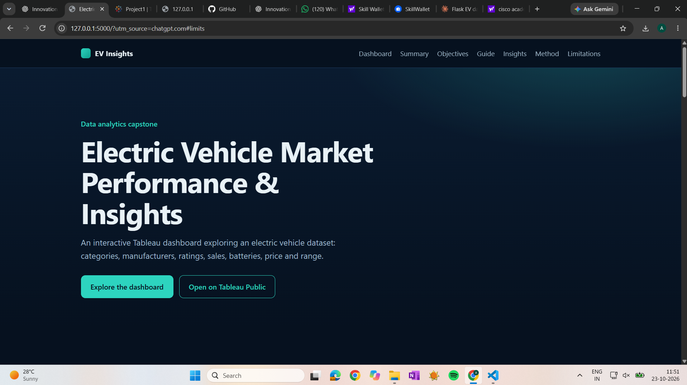
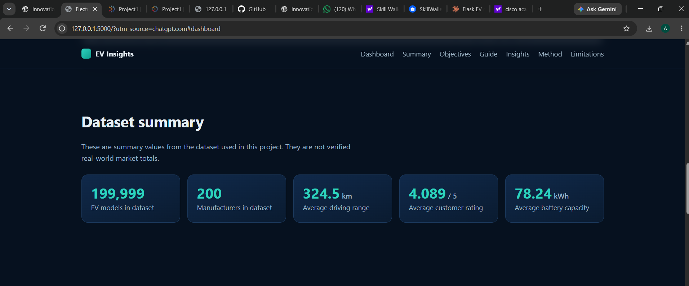

# ⚡ EV Market Performance & Insights

## 📌 Project Overview

This project explores the electric vehicle (EV) market through interactive Tableau dashboards and a Flask-based web application. It analyzes EV categories, manufacturers, driving range, pricing, battery technologies, customer ratings, vehicle efficiency, and annual sales trends to help users understand patterns in the EV market.

## 🎯 Project Objectives

- Analyze the distribution of EV models across categories and manufacturers.
- Compare driving range, pricing, and battery capacity.
- Explore customer ratings and energy efficiency across EV categories.
- Examine annual EV sales trends by model year.
- Understand EV model distribution by battery type and manufacturing country.
- Present the dashboard through a simple, responsive web interface.

## 🌐 Flask Web Application

The project includes a Flask web application that presents the EV dashboard and supporting project information in one place.

**Features:**
- Responsive website layout.
- Embedded Tableau Public dashboard.
- EV KPI metrics and project objectives.
- Project methodology and technology overview.
- Navigation between page sections.

**Technologies:** Python, Flask, HTML, CSS, JavaScript and Tableau Embedding API.

## 📊 Interactive Tableau Dashboard

**Explore the published dashboard here:**

[🔗 View EV Market Performance & Insights on Tableau Public](https://public.tableau.com/app/profile/anarghya.jain4219/viz/Project1_17926889567930/Dashboard2)

## 📈 Key Performance Indicators (KPIs)

- **Total EV Models:** 199,999
- **Total Manufacturers:** 200
- **Average Driving Range:** 324.5 km
- **Average Customer Rating:** 4.089 / 5
- **Average Battery Capacity:** 78.24 kWh

## 🖼️ Flask Dashboard Screenshots

Add your screenshots to the `screenshots/` folder in this repository. Update the filenames below if your actual filenames differ.

### Home Page


### Interactive Tableau Dashboard


### KPI Metrics


### Responsive Mobile View


## 📉 Dashboard Visualizations

The Tableau project includes visualizations covering:

1. EV Category Performance & Distribution
2. EV Model Distribution by Manufacturer (Top 10)
3. Average Customer Rating by EV Category
4. Annual EV Sales Trend by Model Year
5. EV Model Distribution by Battery Type
6. EV Model Distribution by Manufacturing Country
7. EV Price vs. Driving Range
8. Battery Capacity vs. Driving Range
9. EV Efficiency by Category

## 🛠️ Tools & Technologies

- **Python & Flask** — web application and routing
- **HTML** — page structure
- **CSS** — styling and responsive layout
- **JavaScript** — client-side interactions
- **Tableau Public** — interactive data visualization
- **Tableau Embedding API** — embedding the published dashboard
- **CSV** — dataset format
- **GitHub** — version control and project documentation

## 🗂️ Dataset Overview

The dataset contains EV-related attributes such as:

- Vehicle model and manufacturer
- Model year and manufacturing country
- Battery capacity, battery type, and degradation
- Driving range and energy efficiency
- Price, insurance cost, and resale value
- Customer ratings and safety ratings
- Annual sales and estimated CO₂ savings

*Note: The KPIs and charts describe the dataset used for this project. Manufacturer and battery-type charts show model counts, not verified real-world market share. Annual sales trends use the sales values available in the dataset.*

## 💡 Project Outcomes

- Built interactive Tableau dashboards to explore EV market data.
- Developed a Flask web application to present the dashboard and project information.
- Compared EV models across performance, pricing, battery, and customer-rating metrics.
- Created a shareable project interface for exploring the published dashboard.

## 🚀 How to Explore

1. Open the Tableau Public link above.
2. Navigate between the published dashboards and worksheets.
3. Use available charts and filters, if present, to explore the data.
4. To run the Flask application locally, follow the setup instructions below.

## 💻 Run Locally

1. Clone this repository:

   ```bash
   git clone https://github.com/anarghya1008/EV-Market-Performance-Insights.git
   ```

2. Open the project directory and install Flask:

   ```bash
   python -m pip install flask
   ```

3. Start the application:

   ```bash
   python app.py
   ```

4. Open `http://127.0.0.1:5000` in your browser.

## 👤 Author

**Anarghya Jain**

---

⭐ If you find this project useful, feel free to explore the dashboard and share your feedback.
